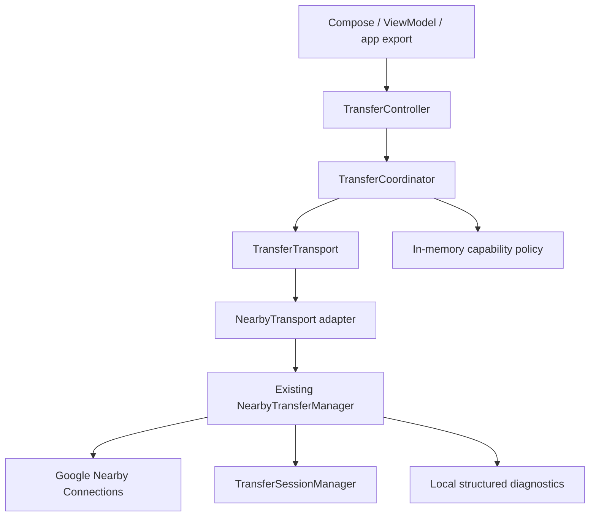

# SwiftDrop Ultra Engine — Phase 1 foundation

## Scope and baseline

Fetched `swiftdrop-android-v0.1-alpha` at
`aee0a237693740663878dc7a7ccb44d856a0a232` before editing. The actual application
is Kotlin/Compose, package `app.swiftdrop`, minimum API 26, target API 35,
compile API 36, version **0.5.0-alpha / 23**. The initial release target remains
**0.6.0-alpha**; this foundation PR deliberately keeps the current version and
signing configuration until release validation is complete. No release is published.

Source inspection confirmed:

- `NearbyTransferManager` uses Play Services Nearby Connections 19.5.1,
  `app.swiftdrop.nearby`, and `P2P_POINT_TO_POINT`.
- `sendNext()` sends metadata followed by one file, then advances on success.
- Play Services and Android select the radio; SwiftDrop cannot promise a band,
  link speed, or Wi-Fi-only transfer.
- Remote disconnection discards incomplete incoming payloads, while fully
  delivered files can finish saving. Explicit disconnect/cancel aborts pending saves.
- There is no independent TCP scheduler, chunk manifest, checkpoint, or resume protocol.
- Receive validation checks byte lengths, not a cryptographic digest.

The existing Compose workflows, galleries, background music service, installed
APK export, scoped storage, permission requests, QR token format, authentication
digits and explicit approval remain connected to the same Nearby implementation.
`TransferModels` adds defaulted lifecycle/transport fields. `TransferMeasurements`,
manifest, media implementation, localized resources, theme and signing settings are unchanged.

## Implemented architecture

The coordinator performs the TransportCoordinator role: transport registration,
pre-session selection and fallback policy. Nearby is required as the unique default.
No migration of an active transfer is allowed. `TransferController` preserves app
operations while `TransferTransport` adds availability and capability information.
Nearby's radio/permission/service errors retain their existing localized recovery UI.
Availability of the adapter means it is registered, not proof that radios or Play
Services are operational. New implementations must perform their own readiness checks.

`UltraEngineFeatures.UltraEngineEnabled = false` is a compile-time default.
Even a registered future transport and a capable peer cannot activate it. No new
capability handshake is encoded or sent. Unknown peers negotiate legacy v1/Nearby
in memory. Unsupported versions or disjoint transport capabilities fail negotiation.
A future capability advertisement alone is not authentication.

`UltraTransferEngineConfig` is a validated scheduler budget contract, not an
implemented transfer scheduler. Defaults are one stream, 64 KiB–1 MiB chunks and
4 MiB buffer budget. No additional worker pools, sockets, resume or SHA-256 claims
are introduced by this configuration.

## Session and file safety

The UI state exposes the transport and session state, including radio-start operations
before their success callbacks. Connection states explicitly model idle, advertising, discovering, approval,
connecting, connected, disconnected, failure, cancellation and closure. Each
session and transfer has an independent UUID; Nearby payload IDs correlate
callbacks. Metadata stays internal and is cleared from terminal ledger entries.

File states are `Active → Saving → Complete` for receives and `Active → Complete`
for sends. Active/saving transfers can fail or cancel; terminal states cannot be
revived. Progress counters reject backward bytes/time. Session replacement rejects
old IDs even when a payload number is reused. The callback ledger is bounded to
4,096 files per connection, including terminal tombstones; exhaustion refuses new
payloads with the existing error UI rather than evicting duplicate protection.
Reconnect explicitly to start a fresh ledger. This is a safety limit, not resume.

Nearby lifecycle/discovery/payload callbacks capture their generation and check
endpoint ownership. Connection success requires the endpoint approved by the user.
Late task failures cannot clear a newer connection or completed send. Send
preparation and save completion return to the main looper before updating callback
state. App export can safely submit selection from its IO executor.

Cancellation serializes with destination publication on the session monitor.
The existing Cancel button now invokes cancellation while saving as well as while
transferring. Copying is performed outside that monitor with the existing bounded 256 KiB buffer and
length validation. Android 10+ uses MediaStore pending entries; API 26–28 uses a
unique temporary file and rename after validation. Cleanup removes this operation's
pending destination or captured Nearby temporary source. Previously finalized files
are retained. History is committed with publication so navigation immediately after
save cannot lose the completion record. Old cleanup tasks never remove map entries
belonging to a replacement session. Local temporary resources are cleaned on failure,
explicit disconnect and closure. Process-death recovery and metadata-arrival
watchdogs are not implemented. Untracked stale payloads have their descriptors
closed; deletion is limited to sources owned by a tracked session. Google Play
Services retains ownership of untracked temporary storage.

The unchanged v1 message is UTF-8 JSON with exactly `type`, `id`, `name`, `size`.
The decoder accepts legacy missing size and unknown extension fields, sanitizes
names, rejects sizes below -1 and rejects messages beyond Nearby's 32 KiB limit.
No proprietary SHAREit protocol or implementation is used.

## Diagnostics and privacy

Terminal transfer records contain transport, connection/transfer state, monotonic
duration, transferred bytes, observed bytes/second, failure category and reconnection
attempts. Rates describe callback-observed elapsed time, not theoretical link speed
or a hardware benchmark. Reconnection attempts remain zero because automatic
reconnection is not implemented. Records omit filenames, paths, peer identity,
UUIDs, file contents, authentication digits/tokens and exception text. Connection transitions also produce records without endpoint or device identifiers. Existing
permission/radio diagnostics remain local. No analytics endpoint or cloud permission
is added. Production log retention/export policy should be reviewed before adding
user-facing diagnostic export.

## Future local-network phase (planned only)

| Transport | Implementation approach | Permissions and platform constraints |
| --- | --- | --- |
| Same-Wi-Fi TCP | Start with authenticated one-stream TLS sessions bound to the selected local `Network`; discover with NSD or explicit QR invitation; validate local addresses; bounded server accepts; do not expose a cloud endpoint | Declare normal `INTERNET`, `ACCESS_NETWORK_STATE`, existing Wi-Fi state permissions; evaluate API 36 local-network protections and API 37 target requirements before implementation; handle network loss and OEM firewalls |
| Wi-Fi Direct | `WifiP2pManager`, user-approved group formation, owner/client role detection and scoped socket binding; release only app-owned groups | Wi-Fi state/change and `INTERNET`; location permissions/location switch on relevant older APIs; Android 13+ `NEARBY_WIFI_DEVICES`; manufacturer group/STA-concurrency restrictions |
| Local-Only Hotspot | `WifiManager.startLocalOnlyHotspot`, scoped reservation lifecycle and QR credentials; user-approved joining via supported network APIs | `INTERNET`, Wi-Fi permissions, API 26+ location requirements and API 33+ nearby-device requirements; OEM/tethering/concurrent-STA limits; never enable internet tethering implicitly |

The manifest currently explicitly removes `INTERNET`. Keep that invariant for
Phase 1. Add it when real local socket code is introduced, with merged-manifest tests
that distinguish local sockets from any cloud feature. Normal INTERNET access has
no runtime prompt. Do not use it as permission to add telemetry or remote networking.

Capability detection must combine documented feature checks, actual API/radio
readiness, runtime grants, local network reachability and authenticated peer
capabilities. A 5 GHz hardware capability does not prove both peers can form a 5 GHz
link or that doing so is faster. Regulatory, OEM, power, thermal and Android-version
constraints must be measured. Never silently switch Wi-Fi, drop the user's internet
connection, set hidden radio options or assume root access.

Fallback is allowed before sending any bytes. Once delivery starts, retry/migration
requires an authenticated manifest, matching file identity and durable checkpoint;
never append blindly to a legacy partial payload. User rejection and authentication
failure must not trigger a weaker automatic transport. Preserve Nearby's current
approval flow and provide clear reasons/actions for permission, unsupported device,
network and storage failures.

If background file transfer is added, evaluate a dedicated `connectedDevice`
foreground service for local peer communication (and `dataSync` only for applicable
work), declare each selected type and corresponding foreground-service permissions,
meet type prerequisites, handle API 31+ start restrictions, API 33 notification
permission, API 34 type checks and API 35 dataSync limits. Provide a persistent
localized progress/cancel notification and stop the service when idle. The existing
`mediaPlayback` service remains exclusively for music. No transfer FGS is added here.

## Future adaptive-transfer phase (planned only)

1. Authenticate peer/session identity with platform-supported cryptography. Bind
   protocol version, capabilities, manifest and resume requests to the authenticated
   channel. QR/bootstrap secrets require freshness, expiry and replay protection;
   a Nearby endpoint or device name is not persistent identity.
2. Prototype one TLS stream on same Wi-Fi first. Measure throughput, CPU, memory,
   energy and storage cost before adding concurrency. Use bounded workers, bounded
   queues, negotiated chunk bounds and sender/receiver backpressure.
3. Adapt chunk size/concurrency from sustained measurements and receiver/disk limits
   with hysteresis. Reduce work under stalls or thermal pressure. Test one, two and
   four streams; more sockets can reduce performance. Keep a strict buffer budget.
4. Define a versioned manifest containing stable transfer/file IDs, 64-bit sizes,
   chunk ranges, digests and complete-file SHA-256. Stream digests without whole-file
   buffering. Unknown-length or non-seekable content-provider sources need explicit
   policies; avoid speculative copying simply to make them seekable.
5. Persist verified chunk checkpoints transactionally in app-private storage; bind
   them to peer identity, source identity and manifest digest. Check free storage,
   TTL and limits; reject corrupt, expired or cross-peer checkpoints. Mark chunks
   committed only after the chosen durability boundary. Handle crash recovery.
6. Resume only missing validated ranges. Verify SHA-256 before publishing; fsync
   where supported and atomically finalize the destination. SAF/MediaStore providers
   have different atomicity guarantees that need provider-specific testing.
7. Test fault injection, malicious lengths/ranges, reordering, replay, disk-full,
   cancellation and interrupted finalization. UDP is not a file-delivery shortcut.

## Validation checklist

- [x] Fetch latest branch and inspect source/version/CI.
- [x] Preserve Nearby default, identity, signing, permissions and wire protocol.
- [x] Introduce interface/adapter/coordinator and disabled feature flag.
- [x] Add capability policy, bounded session state machines and private diagnostics.
- [x] Add automated protocol/session/coordinator/concurrency regression tests.
- [x] Add Robolectric tests of real Nearby lifecycle callbacks using an injected client. No radio access is performed.
- [x] Final Gradle unit tests (110 passing), Android Lint (0 errors) and debug/instrumentation APK assembly.
- [ ] Execute emulator UI suite (English/Arabic, RTL, themes, media, selection, QR).
- [ ] Physical-device validation before release or enabling the Ultra Engine.

Physical tests are **unperformed**. Required matrix: Android 8–16 across at least
two manufacturers; upgraded legacy/new sender and receiver combinations; 100 MB,
1 GB, >2 GB, empty and many-small-file transfers; SHA-256 comparison using an
independent device/host tool; interruption during transport/save/finalization;
low storage and content-provider errors; cancel and rapid reconnect with late
callbacks; denied/revoked permissions; backgrounding and background music; rotation;
Wi-Fi/network switching; gallery/app sharing; English/Arabic, RTL, light/dark and
large text. Record models, OS/Play Services versions, byte counts, hashes, duration,
CPU/memory/thermal conditions and actual failures. Do not infer hardware results
from JVM tests or emulator compilation.

The repository-level SwiftDrop workflow still validates target-branch pushes with
its existing unit/Lint/APK/emulator/signing checks. Publication now additionally
requires an explicit manual dispatch with `publish_release=true` (default false),
so validation pushes cannot overwrite the existing alpha release. This isolated PR
does not target that push trigger; no workflow dispatch, release, merge or publication
is performed. Keep the PR draft until device/UI validation and release policy review
are complete. No new Actions builds are triggered by this PR.
